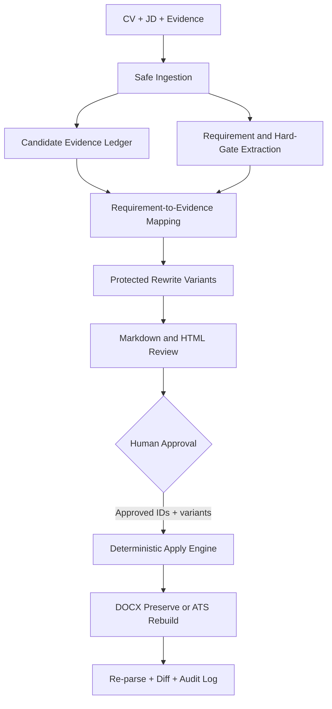

# Architecture



The intelligence layer may propose language, but evidence validation, approval, hashing, edit application, and final verification remain deterministic.

## Release-confidence path

```text
unittest + benchmark + CLI lifecycle
                 |
                 v
        branch-aware coverage.json
          |                   |
          v                   v
 global working target   changed executable statements
      >= 91%                    100%
          |                   |
          +---------+---------+
                    v
             release receipt

scheduled/manual Linux pilot
          |
          v
detached worktree -> 4 authority-boundary mutations -> JSON summary
```

The source-level hard floor remains 90%. The shared CI runner enforces a 91%
working target for margin and checks that every changed executable statement in
`src/ats_agent` ran. A hash-manifested synthetic document corpus exercises TXT,
valid DOCX, malformed DOCX, and strict-preserve behavior without candidate data.
Mutation testing is bounded to `workflow.py`, `evidence.py`, `documents.py`, and
`validation.py`; it runs only in a disposable worktree and is non-blocking until
two Linux baselines establish a stable runtime and survivor policy.

## Boundaries

- `ingestion.py` reads documents and reports quality.
- `evidence.py` owns candidate facts and provenance.
- `requirements.py` owns JD requirements, hard gates, and mappings.
- `rewriting.py` constructs safe variants from supported facts.
- `validation.py` prevents factual and ownership escalation.
- `documents.py` performs anchored edits.
- `workflow.py` coordinates the contract without bypassing a boundary.
